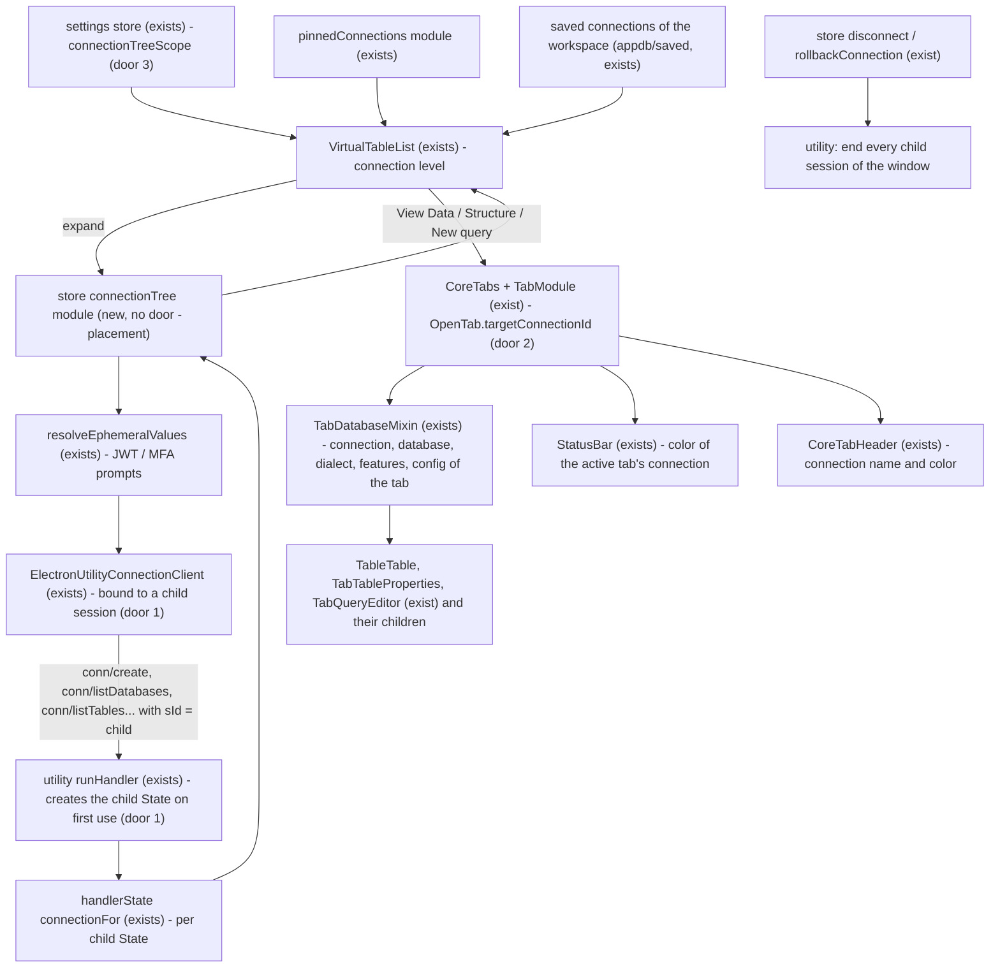
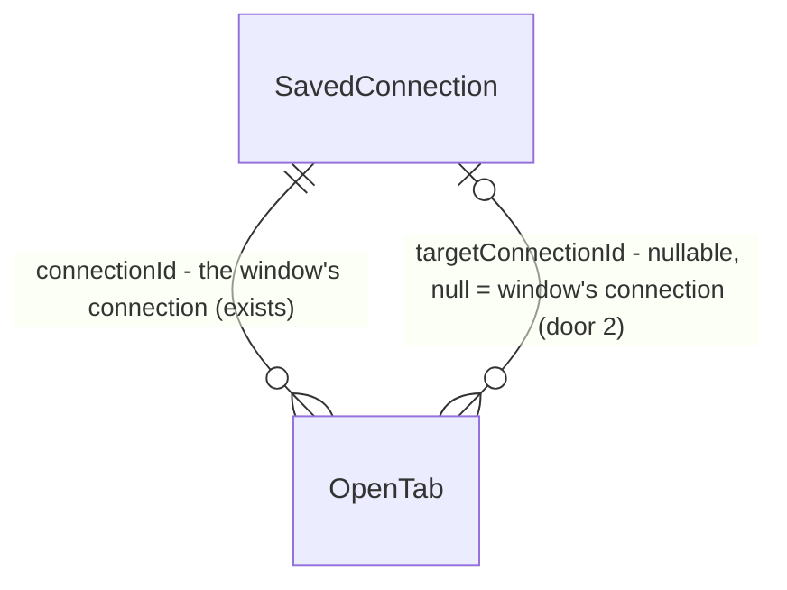

# Saved connections as parent nodes of the entity tree

> tlc-spec-lean · feature `multi-connection-tree` · profile `standard` (the level the user set for
> `multi-database-polish` on 2026-10-16; no AGENTS.md declaration).
> Builds on `multi-database-navigation` (database nodes, `connectionFor`, tabs bound to a
> database) and `multi-database-polish` (locked databases, database colors, reveal). The sidebar
> filter fix is its own feature, `tree-filter-all-databases`, built first on the same branch.

## Problem

A window holds one connection. The entity tree shows that connection's databases, and every tab
runs on it. To read a table on another server, the user disconnects or opens a second window,
and loses the tree, the tabs and the status bar color of the first one. Comparing data across
two servers (staging and production, or an app database and its reporting replica) means
juggling windows that look identical except for the bottom bar. The saved connections, their
colors and pins already exist in the app, but none of that can be used from inside a connected
window. The user asked for it on 2026-10-21 and gave no figures.

Once this ships, the entity tree has a connection level. The window's own connection is the
first node, as today. Below it, the user's saved connections are listed (only the pinned ones,
or all of them - a setting), each with its saved color. Expanding one connects it in the
background and lists its databases and entities. Opening a table or a query from it opens a tab
that runs on that connection, shows its name and color, and turns the status bar to that color
while the tab is active.

## Flow

This reuses the utility's per-session `State` (one server, its database clients, eviction and
sweep from `multi-database-navigation`) by giving each secondary connection its own session, and
reuses `conn/create`, `connectionFor`, `ElectronUtilityConnectionClient`, `resolveEphemeralValues`
and the database-node rendering of `VirtualTableList`. No `conn/*` handler changes its signature.

1. `VirtualTableList` builds the connection level from the window's connection plus the saved connections allowed by `connectionTreeScope` (door 3): none (`off`), pinned only (`pinnedConnections`), or every saved connection of the current workspace. The window's own saved connection is never listed twice
2. Expanding a secondary connection → `connectionTree` store module (new, placement): runs `resolveEphemeralValues` (exists), then `conn/create` through an `ElectronUtilityConnectionClient` whose `send` sets `sId` to the child key (door 1). `UtilityConnection.send` already lets an explicit `sId` win over its own (`{ sId: this._sId, ...args }`)
3. The utility's `runHandler` (exists) sees an unknown child key whose parent session exists, creates a `State` for it that shares the parent's port, and runs the handler. `conn/create`, `connectionFor`, eviction and the sweep then work per child exactly as they do for the window
4. The module loads the child's `databaseList`, `inaccessibleDatabases`, `supportedFeatures`, `defaultSchema` and the default database's entities; other databases of that connection load on expand, as today. `VirtualTableList` renders them with the existing database, schema and entity items
5. Opening an entity or a query from a secondary node → `CoreTabs` (exists) → `tabs/add` (`TabModule`, exists) persists `OpenTab.targetConnectionId` (door 2) next to `databaseName`. The tab still belongs to the window's connection (`connectionId`), so it is restored with the window's tabs
6. `connectionForTab` (exists) and `TabDatabaseMixin` (exists) resolve the tab's client from `targetConnectionId` + `databaseName`, and also give the tab its connection's dialect, `dialectData`, `supportedFeatures` and saved config (read-only mode). A restored tab whose connection is not open yet connects it on first use (step 2)
7. `StatusBar` (exists) and `CoreTabHeader` (exists) read the active tab's connection color and name
8. Disconnect: the node's `Disconnect` sends `conn/disconnect` + `conn/clearConnection` to the child and drops it from the module. The window's `disconnect` / `rollbackConnection` (exist) do the same for every child before their own, and the utility's `close` of a window removes its child states

## Impact

| Front | What changes |
| --- | --- |
| domain | New term **secondary connection**: a saved connection opened from the tree inside a window that is connected to another one. It has its own utility session and is never the window's connection. |
| domain | New term **target connection** of a tab: the saved connection the tab runs on. `null` means the window's connection, which is every tab that exists today. `OpenTab.connectionId` keeps its meaning: the window connection whose tab list holds the tab. Code that branches on `connectionId` today: `TabModule` load/save, `tabhistory` (closed-tab history), `OpenTab.matches`. |
| domain | `TabDatabaseMixin` stops meaning "database of the tab" only: it becomes the tab's whole connection context (client, database, dialect, features, config). Components that read the root getters `dialect`, `dialectData`, `supportedFeatures` or `usedConfig` while rendered inside a table, structure or query tab must read them from the mixin, or they show the window's dialect for a tab on another server. The build sweeps those components; 14 already use the mixin, about 40 read the root getters. |
| behaviour | The tree gains a top level whenever at least one secondary connection is listed. With no listed connection (scope `pinned` and nothing pinned) the tree is exactly today's. |
| behaviour | `StatusBar`'s color follows the active tab's target connection instead of always the window's. `ConnectionButton` (name, disconnect menu) keeps showing the window's connection. |
| behaviour | Opening a secondary connection records a use in `UsedConnection` (recent connections), because it goes through `conn/create`. |
| behaviour | The pinned connections list (`pinnedConnections/orderedPins`) only resolves pins whose connection is loaded in `data/connections`, which loads per expanded folder. The tree needs every pinned or saved connection of the workspace regardless of folder state, so it reads its own full list. |
| resources | Each open secondary connection holds its own pool, its own SSH tunnel if configured, and up to `maxOpenDatabases` extra database clients, until it is disconnected or the window disconnects. |
| stored data | `tabs` gains a nullable integer `targetConnectionId`. Existing rows stay `NULL` (window's connection). No backfill. |
| stored data | New user setting row `connectionTreeScope`, created on first change. Absent means `pinned`. |

## Relations

One-way constraint: `targetConnectionId` is nullable and `NULL` keeps today's meaning. No foreign
key: deleting a saved connection leaves the tab, which then shows the missing-connection state
(AC 23).

## Surface

None - nothing consumed outside. The `conn/*` IPC routes are internal (renderer ↔ utility,
shipped together) and keep their signatures; the child session key (door 1) is the only new
thing they carry. The plugin API is unchanged (see Out of scope).

## Landing

| One-way door | Literal shape | Alternative rejected |
| --- | --- | --- |
| 1 · Child utility session per secondary connection | session key `` `${windowSid}::connection::${savedConnectionId}` ``, passed as `sId` by `ElectronUtilityConnectionClient` (`forConnection(savedConnectionId)`); the utility creates its `State` on first use when the parent `windowSid` exists, shares the parent's `port`, and removes every child on the parent's `close` | A `connectionId` routing param on every `conn/*` handler: about 80 handler signatures and a second dimension in `connectionFor`, a large rewrite of upstream files this fork syncs. One utility process per connection: a new process lifecycle in the main process for state that already isolates per session. |
| 2 · Tab bound to a target connection | migration `20261021_add_tab_target_connection_id.js`: `ALTER TABLE tabs ADD COLUMN "targetConnectionId" integer NULL`; `OpenTab.targetConnectionId: number \| null` in `pickable`; `matches()` compares it (null = window's connection) for every tab type | Not persisting secondary tabs: they would vanish on restart while their window's other tabs come back. Saving the tab under the target's `connectionId`: it would disappear from this window and show up in the target's own window. |
| 3 · Scope setting | user setting `connectionTreeScope` with values `"pinned"` \| `"all"`, default `"pinned"` when absent, saved with `settings/save` and switched from the Entities header menu. **Amended 2026-10-22 (captain's plan review):** values are `"off"` \| `"pinned"` \| `"all"`, default still `"pinned"`; `"off"` hides the connection level | A `[ui.tableList]` key in `user.config.ini`: needs a file edit and a restart for something the user flips while working. A per-connection option: the list is the user's, not one connection's. |

- Nothing else is hard to reverse. The `connectionTree` store shape, the node layout and the context menus are refactorable.

## Criteria

### S1: Connection level in the entity tree (P1)

The tree lists the window's connection and the saved connections the scope allows.

**Acceptance Criteria**

1. WHERE `connectionTreeScope` is `pinned` (or absent), the tree SHALL list, after the window's connection node, one node per pinned saved connection of the current workspace, in pin order, excluding the window's own saved connection
2. WHERE `connectionTreeScope` is `all`, the tree SHALL list, after the window's connection node, one node per saved connection of the current workspace, ordered by name (case-insensitive), excluding the window's own saved connection, whether or not its folder is expanded in the connection sidebar
3. IF the scope lists no secondary connection THEN the tree SHALL render no connection level, exactly as before this feature
4. The tree SHALL show the window's connection as the first connection node, expanded on connect, with today's tree under it
5. The tree SHALL show, on every connection node, the connection's name and its saved `labelColor` (no color mark for `default`)
6. WHEN the user picks "No other connections", "Pinned connections" or "All saved connections" in the Entities header menu THEN the system SHALL save `connectionTreeScope` as `off`, `pinned` or `all` and SHALL rebuild the connection level without a restart
7. WHEN a saved connection is pinned, unpinned, renamed, recolored, created or deleted THEN the connection level SHALL reflect it the next time the tree is rebuilt, without reconnecting the window
8. The tree SHALL never list a connection that is not saved (quick connect, URL, recent-only)
35. WHERE `connectionTreeScope` is `off`, the tree SHALL render no connection level, even when saved connections are pinned (added 2026-10-22 from the captain's plan review)

**Independent test:** pin two saved connections, connect to a third. The tree shows the third
on top and the two pinned ones under it with their colors. Switch the menu to "All saved
connections" and every saved connection appears; unpin both with the scope back on pinned and
the tree is exactly today's.

### S2: Opening a secondary connection from the tree (P1)

Expanding a secondary connection connects it and lists its databases and entities, without
touching the window's connection.

**Acceptance Criteria**

9. WHEN a collapsed, not-connected secondary connection node is expanded THEN the system SHALL send `conn/create` with that saved connection's config under `sId` = `` `${windowSid}::connection::${id}` `` exactly once, and SHALL NOT send any message under the window's `sId` that changes the window's server, database or tabs
10. WHILE a secondary connection is connecting, its node SHALL show a loading indicator
11. IF connecting a secondary connection fails THEN its node SHALL show the driver error and a Retry action, and the utility SHALL hold no server for that child session
12. WHEN a secondary connection is connected THEN the tree SHALL render its databases, with its default database expanded and loaded, using the same database, locked, schema and entity items as the window's connection; WHERE its dialect sets `disabledFeatures.multipleDatabases`, its schemas and entities SHALL render directly under the connection node
13. WHEN a non-default database of a secondary connection is expanded THEN `conn/listTables` SHALL be sent under that connection's child `sId` with `database` equal to that database
14. WHEN the same secondary connection node is expanded twice while its connect is in flight THEN `conn/create` SHALL be sent once
15. WHERE the saved connection needs an ephemeral value (CockroachDB JWT, Snowflake MFA passcode), WHEN its node is expanded THEN the system SHALL show the same prompt as the connection screen, and IF the prompt is cancelled THEN the node SHALL stay collapsed and not connected
16. WHEN "Disconnect" is chosen on a connected secondary connection node THEN the system SHALL send `conn/disconnect` and `conn/clearConnection` under its child `sId`, collapse the node and clear its databases and entities
17. WHILE a tab bound to a secondary connection has an active transaction or a reserved connection, that node's "Disconnect" action SHALL be disabled
18. WHEN the window's connection disconnects (or `rollbackConnection` runs) THEN every child session of the window SHALL be disconnected and the `connectionTree` state SHALL be empty
19. WHEN the utility receives `close` for a window session THEN it SHALL remove every child `State` of that session
20. WHILE the sidebar filter query is non-empty, it SHALL apply to the loaded entities of secondary connections with the same rules as `tree-filter-all-databases` AC 1-6

**Independent test:** connected to a local Postgres, expand a pinned MySQL saved connection. Its
databases appear, the default one expanded; the window's database dropdown, tabs and status bar
do not change. Disconnect it from its menu and it collapses.

### S3: Tabs that run on a secondary connection (P1)

A tab opened from a secondary node runs on that connection, with its dialect, until it is closed.

**Acceptance Criteria**

21. WHEN "View Data" or "View Structure" is chosen on an entity of secondary connection `C`, database `d` THEN the new tab SHALL persist `targetConnectionId = C.id` and `databaseName = d`, and every `conn/*` call it makes SHALL be sent under `C`'s child `sId` with `database: d` (or no `database` key when `d` is `C`'s default database)
22. WHEN "New query" is chosen on secondary connection `C` or on one of its databases THEN a query tab SHALL open with `targetConnectionId = C.id` and `databaseName` equal to that database (the connection's default database from the connection node), and its executions SHALL be sent under `C`'s child `sId`
23. IF a tab's `targetConnectionId` names no saved connection of the current workspace THEN the tab SHALL show "Saved connection not found" and SHALL send no `conn/*` call
24. WHEN a tab with a `targetConnectionId` whose connection is not open is restored after a restart and first used THEN the system SHALL connect that secondary connection as in AC 9 and the call SHALL resolve without other user action
25. The system's `matches()` SHALL return `false` for two tabs that differ only in `targetConnectionId` (null and `C.id` are different)
26. WHILE a tab is bound to secondary connection `C`, the components rendered in that tab SHALL use `C`'s dialect, `dialectData` and `supportedFeatures` - including identifier quoting in generated SQL, the query editor's autocomplete entities (from `C`'s database), and which table-view actions are enabled
27. WHERE secondary connection `C` has `readOnlyMode` on, its tabs SHALL disable the same editing controls a read-only window connection disables, whatever the window connection's mode
28. WHILE a query tab is bound to secondary connection `C`, its database selector SHALL list `C`'s databases and changing it SHALL update the tab's `databaseName` only
29. The tab header of a tab bound to secondary connection `C` SHALL show `C`'s name next to the database name, with `C`'s `labelColor` mark
30. The system SHALL run tabs with `targetConnectionId = NULL` exactly as before this feature
31. The tree SHALL limit entity actions on secondary connections to View Data, View Structure, New query and Copy Name; export, import, backup, create, drop, truncate, duplicate, pin, hide and database color SHALL NOT be offered on secondary nodes

**Independent test:** with a Postgres window and an expanded MySQL secondary connection, open a
MySQL table and a MySQL query tab. Queries return MySQL rows, generated SQL uses backticks, the
tab headers show the MySQL connection's name and color; restart the app and both tabs still run
on MySQL.

### S4: Status bar follows the active tab's connection (P1)

**Acceptance Criteria**

32. WHILE the active tab is bound to secondary connection `C`, the status bar SHALL carry `C`'s `labelColor` class (`default` when `C` has none) instead of the window connection's
33. WHILE the active tab has no target connection, or no tab is active, the status bar SHALL carry the window connection's `labelColor` class, as today
34. WHEN the active tab changes between tabs of different connections THEN the status bar color SHALL change on the same render

**Independent test:** window connection red, secondary connection blue. Switch between a red
tab and a blue tab and the bottom bar follows; close the blue tab and it stays red.

## Out of scope

| Excluded | Why |
| --- | --- |
| Quick Search (Ctrl/Cmd+P) over secondary connections | Its index is the window connection's (`SearchModule`); a separate change |
| Pins, hidden entities and database colors on secondary connections | Those records are keyed by the window's connection; would need their own scoping |
| Export, import, backup, SQL generator, create/drop/truncate on secondary connections | Same reason the previous feature hid them on non-default databases: those flows are built on the window's connection |
| Promoting a secondary connection to the window's connection | Use the connection screen as today |
| Plugin API awareness of secondary connections | `PluginStoreService` keeps reporting and running on the window's connection; a known limitation accepted in the captain's plan review (2026-10-22) |
| Recent (unsaved) connections in the tree | The request limits the tree to saved connections |
| A cap on open secondary connections | Each one is opened and closed by the user; database clients inside each are already capped by `maxOpenDatabases` |

## Assumptions

| Assumption | Chosen default | Rationale | Confirmed? |
| --- | --- | --- | --- |
| Order in `all` scope | by name, case-insensitive; pinned ones are not floated | predictable and matches the connection list's default sort | n |
| Saved connection with no remembered password | connects with what is saved; the driver's auth error shows on the node (AC 11) | a password prompt in the tree is a new flow; the connection screen still works | n |
| `security.lockMode = "pin"` | the connection level is not shown | `conn/create` requires the PIN; asking for it from the tree is a new flow | n |
| What "using a database of a connection" means for the status bar | the active tab's target connection | the tree selection alone does not run anything | n |
| Window connection node | listed first, uses the window connection's name and color, has no new menu | disconnecting it stays in `ConnectionButton` | n |
| Workspace | secondary connections come from the window's current workspace (local or cloud) | pins and saved connections are per workspace | n |

**Open questions:** none - all three were answered in the captain's plan review (2026-10-22):
`off` was added to `connectionTreeScope` (door 3, AC 6, 35); the plugin API stays unchanged for
secondary-connection tabs, a known limitation (Out of scope); secondary connections reconnect
lazily after a restart (AC 24), nothing reconnects on start-up.

## Observable

| Surface | Decision | Landing |
| --- | --- | --- |
| screen tree connection node | empty state (connected, no databases or entities) | existing - the empty database/schema rendering under the node |
| screen tree connection node | loading state | AC 10 |
| screen tree connection node | error state | AC 11 |
| screen tree connection node | unauthorised (no remembered password, locked database) | AC 11 (auth error on the node); locked databases as `multi-database-polish` |
| screen tree connection level | ordering | AC 1, 2 |
| screen tree connection level | density | AC 3 - no level when nothing is listed |
| screen tree connection node | destructive action confirms | AC 17 - Disconnect disabled while a transaction is open; otherwise it only closes the session, tabs reconnect on use (AC 24) |
| screen Entities header menu | scope switch | AC 6 |
| screen tab on a secondary connection | error state (connection deleted) | AC 23 |
| screen tab on a secondary connection | which connection it runs on | AC 29 |
| screen status bar | color | AC 32-34 |
| collection: listed connections | grouping, duplicates, the exception | AC 1, 2, 8 - no folders, the window's own connection never repeated, unsaved never listed |
| IPC `conn/*` under a child `sId` | error shape | AC 11 - the driver error passes through unchanged |
| IPC `conn/*` | versioning, rate limits | n/a - internal IPC, renderer and utility ship together |
| UI copy | neutral tone (CLAUDE.md) | AC 6, 23 and the Disconnect / New query menu labels |

## Sources

- User request (2026-10-21): connections as parent nodes in the tree, open databases across connections without switching, saved connections only, saved color respected, status bar color follows the connection in use, configurable pinned-only vs all saved connections.
