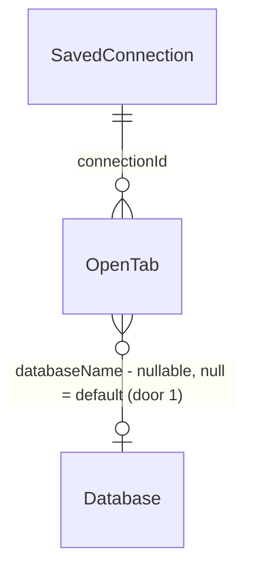

# Multi-database navigation

> tlc-spec-lean · feature `multi-database-navigation` · profile `light` (no AGENTS.md declaration)
> On approval this file is copied to `.specs/features/multi-database-navigation/plan.md`,
> `validate_plan.py` runs, and only then is `checks.md` derived. No code before `checks.md`.
> Decisions Q1=A and Q2=A were answered by the user in the Lavish review. S4 (client limit + idle
> eviction + transparent recreate) was added at the user's request after the first plan review.

## Problem

On a connection that holds several databases (Postgres, MySQL, SQL Server, ClickHouse...), the
sidebar, the tabs and Quick Search only see the **active** database. To find a table in another
database the user has to switch the whole window with the database dropdown (`changeDatabase`,
`src/store/index.ts:673-686`). That replaces `tables`/`routines`, and every open tab of the
previous database falls into "This table does not exist in the selected database"
(`TabWithTable.vue:6-19`). Two databases can never be worked on side by side, and Quick Search
(`SearchModule.ts:91-112`) can only jump to another database by switching to it. DBeaver users
expect a `connection > database > schema > table` tree with editors bound to their own database.
The source gives no usage figures.

Once this ships, the sidebar lists every database of the connection as a node. A non-default
database loads its entities on expand. Every tab (table data, structure, query) remembers its own
database and keeps working when another one is opened or the default changes. Quick Search finds
entities of every database loaded in the session.

## Flow

This reuses the utility-side per-database client cache `server.db[dbName]` (`server.ts:23-84`) and
the `changeDatabase` creation path instead of adding a second connection manager. Clients are
resolved per call, not switched.

1. The user expands a database node → `VirtualTableList` (exists) emits a load for that database → store action `loadDatabaseEntities(db)` (exists as `updateTables`, generalised) → `connection.forDatabase(db)` (`ElectronUtilityConnectionClient`, exists) sends `conn/listTables` / `conn/listViews` / `conn/listRoutines` with `database` (door 2)
2. `connHandlers` (exists) → `connectionFor(sId, database)` in `handlerState` (exists). For null or the active database it returns `state.connection`. Otherwise it returns `server.db[key]`, or calls `server.createConnection(key)` + `connect()` and destroys the client if connect fails. The result goes back to the store.
3. The store (exists) writes `databaseEntities[db] = { tables, routines, status }`. The active database still lives in `tables`/`routines`, and `tablesFor(db)` resolves either. `VirtualTableList` renders `database > schema > entity`, and pins and hidden entities filter per node.
4. Opening an entity → `CoreTabs.openTable` / `openTableProperties` (exists) with `database` → `tabs/add` (`TabModule`, exists) persists `OpenTab.databaseName` (door 1)
5. `TableTable` (exists), `TabTableProperties` (exists), `TableSchema` (exists) and `TabQueryEditor` (exists) use `tab.databaseName ? connection.forDatabase(tab.databaseName) : connection` for every call, including reserve/query/release and the transaction timeout, which captures the client it resolved.
6. Quick Search: the `search/database` getter (`SearchModule`, exists) indexes `tablesFor` of every loaded database plus every database name. Picking a table emits `loadTable` with its database. Picking a database emits an expand-and-load event to `VirtualTableList` and no longer calls `changeDatabase`.
7. Lifecycle: `connectionFor` stamps `lastUsedAt` on the resolved client in `server` (exists). Before it creates a new non-default client, it checks `maxOpenDatabases` (door 3) and evicts the least-recently-used non-default client that is idle (no reserved connection, no open transaction). A periodic sweep in the utility disconnects non-default clients that have been idle longer than `idleDatabaseTimeout` (door 3) and deletes them from `server.db`. Nothing is sent to the renderer. The next call that names that database goes through `connectionFor`, which recreates the client: a "dead" tab or tree node comes back on its next use.
8. Disconnect: `conn/disconnect` → `server.end()` (exists) closes every cached client, stops the sweep, then closes the SSH tunnel. The store clears `databaseEntities`.

## Impact

| Front | What changes |
| --- | --- |
| domain | The database dropdown sets the **default database**: the one new tabs bind to and the node expanded on connect. It no longer decides which database an open bound tab uses. Callers that branch on `state.database` today: `App.vue:122`, `CoreSidebar.vue:86`, `TabShell.vue:186`, `TableListItem.vue:211`, `BackupSettings.vue:242`, `PinModule`, `HideEntityModule`, `PluginStoreService.ts:255`. |
| domain | `tables` still means "entities of the default database". New term `databaseEntities` means entities of non-default databases, loaded lazily. `TabWithTable`, `TabModule.fatTabs` and query autocomplete switch to `tablesFor(tab.databaseName)`. |
| domain | `OpenTab.matches` / `TransportOpenTab.matches` now compare the database (null = default) for `table`, `table-properties` and `import-table`. |
| behaviour | `BasicDatabaseClient.disconnect()` no longer shuts down the shared SSH tunnel. Only `server.end()` does. Today, dropping one client kills the tunnel for all. |
| behaviour | `conn/disconnect` ends the whole server (every cached client). Today it leaks the clients that `changeDatabase` created. |
| behaviour | SurrealDB: `createConnection` stores clients under the full `ns::db` key, fixing today's leak where the cache is looked up with `ns::db` but written with `db`. |
| stored data | `tabs` gains a nullable `databaseName`. Existing rows stay `NULL` and mean "default database", so behaviour is unchanged on upgrade. No backfill. |
| resources | Each expanded non-default database opens its own client/pool. On Postgres that is one pool per database, up to `db.default.maxConnections` = 8 each. It is lazy only, capped by `maxOpenDatabases` (default 5 non-default clients), and an idle client closes after `idleDatabaseTimeout` (default 10 min). The default database's client is never evicted. |

## Relations

One-way constraint: `databaseName` is nullable, and `NULL` keeps today's meaning (follow the
default database). No columns or types here beyond the door.

## Surface

`None - nothing consumed outside`: the `conn/*` IPC handlers are internal (renderer ↔ utility, shipped together). Their signature change is the optional `database` arg (door 2), covered by AC 2, 7, 8, 12; `conn/disconnect` ending the whole server is AC 9.

## Landing

| One-way door | Literal shape | Alternative rejected |
| --- | --- | --- |
| 1 · Tab bound to a database | migration `20261015_add_tab_database_name.js`: `ALTER TABLE tabs ADD COLUMN "databaseName" varchar NULL`. `OpenTab.databaseName: string \| null`, in `pickable`. SurrealDB stores the server key `ns::db`. New tabs store the default database explicitly. | Keeping the database only in memory: tabs would lose their database on restart. A non-null column with backfill: it would freeze old tabs on a database the user may have meant to follow. |
| 3 · User-editable config keys | `[db.default]` `maxOpenDatabases = 5` ; `idleDatabaseTimeout = 600000 ; 10 minutes`, typed in `src/typings/bksConfig.d.ts`, overridable per dialect section like `manualTransactionTimeout` | Hard-coded constants: they can't be tuned for a server with low `max_connections`. A per-connection UI setting: it needs a schema change and a form for a rarely tuned value. |
| 2 · IPC routing param | optional `database?: string` on `conn/*` args, injected last by `ElectronUtilityConnectionClient.send` when the client was built with `forDatabase(db)`. The stale positional `database` params on `listTableColumns`, `getTableLength` and `selectTop` are removed. | A separate `conn-db/*` channel set: it duplicates ~80 handlers. A `changeDatabase` before each call: it races between tabs and moves the window. |

- Nothing else is hard to reverse. The store shape, the tree layout and the client cache policy are all refactorable.

## Criteria

### S1: Database tree in the sidebar (P1)

**Acceptance Criteria**

1. WHERE the dialect does not set `disabledFeatures.multipleDatabases`, the sidebar SHALL render one node per entry of `databaseList`, with the default database expanded on connect
2. WHEN a collapsed non-default database node is expanded for the first time THEN the system SHALL send `conn/listTables` with `database` equal to that node's name exactly once, and SHALL render its schemas and entities under it
3. WHILE a database node's entities are loading, the node SHALL show a loading indicator
4. IF loading a database fails (for example, permission denied) THEN the node SHALL show the driver error and a retry action, and the utility SHALL drop that database's client from `server.db`
5. WHEN a database node is collapsed THEN the system SHALL hide every descendant row, including those under expanded schemas
6. WHERE the dialect sets `disabledFeatures.multipleDatabases`, the sidebar SHALL render no database level (today's flat schema list)
7. WHEN `connectionFor(sId, db)` is called with `db` null or equal to the active database THEN it SHALL return `state(sId).connection` without creating a client
8. WHEN `connectionFor(sId, db)` is called twice with the same non-active `db` THEN `server.createConnection` SHALL be called once
9. WHEN a non-default database client is disconnected THEN the shared SSH tunnel SHALL remain open, and WHEN `conn/disconnect` runs THEN every client in `server.db` SHALL be disconnected and `server.sshTunnel` SHALL be `null`
10. WHEN the store's `disconnect` runs THEN `databaseEntities` SHALL be empty
11. The system SHALL apply pinned and hidden entities only under the database node whose name equals their `databaseName`

**Independent test:** connect to a Postgres server with databases `a` and `b`, expand `b`, and see `b.public.*` while `a` stays the default.

### S2: Tabs bound to their database (P1)

**Acceptance Criteria**

12. WHEN an entity under database `b` is opened (data or structure) THEN the new tab SHALL persist `databaseName = "b"`, and its queries SHALL be sent with `database: "b"`
13. WHEN a new query tab is created THEN it SHALL persist `databaseName` equal to the default database
14. WHEN the default database changes via the dropdown THEN tabs with a non-null `databaseName` SHALL keep running against their own database, and their table SHALL still resolve
15. WHEN a tab has `databaseName = NULL` (a row from before the migration) THEN it SHALL use the default database, as today
16. The system's `matches()` SHALL return `false` for two `table` tabs with the same schema and table name but different `databaseName`
17. WHEN the user picks another database in a query tab's database selector THEN that tab's `databaseName` SHALL be updated, and later executions SHALL use it
18. WHILE a query tab has an active transaction or a reserved connection, its database selector SHALL be disabled
19. WHEN a transaction timeout fires THEN the rollback SHALL run on the client that started the transaction
20. IF a bound tab's table is not found in its database's entities THEN the tab SHALL show the existing "does not exist" state

**Independent test:** open `a.public.users` and `b.public.orders` side by side, run a query in each, switch the default database, and both keep working after an app restart.

### S3: Quick Search across databases (P2)

**Acceptance Criteria**

21. WHEN a database's entities are loaded THEN `search/database` SHALL index them with a title that contains the database name
22. The Quick Search index SHALL include one database item per entry of `databaseList`
23. WHEN a table result from database `b` is selected THEN a tab bound to `b` SHALL open
24. WHEN a database result is selected THEN the system SHALL expand and load that node and SHALL NOT dispatch `changeDatabase`

**Independent test:** with `b` expanded, Ctrl/Cmd+P → `orders` lists `b · public.orders`, and Enter opens it bound to `b`.

### S4: Bounded clients with transparent recreate (P1)

**Acceptance Criteria**

25. WHEN a new non-default client is needed while `maxOpenDatabases` non-default clients are open THEN the system SHALL disconnect the least-recently-used idle non-default client before it creates the new one
26. IF a new non-default client is needed while `maxOpenDatabases` non-default clients are open and none is idle THEN the call SHALL reject with an error whose message names the limit value, and SHALL NOT open a connection
27. WHEN a non-default client has had no call for longer than `idleDatabaseTimeout` and has no reserved connection or open transaction THEN the sweep SHALL disconnect it and remove it from `server.db`
28. The system SHALL NOT evict the active database's client, or a client with a reserved connection or open transaction
29. WHEN a tab or tree node issues a call for a database whose client was evicted THEN `connectionFor` SHALL create a new client, and the call SHALL resolve without user action
30. WHEN `conn/disconnect` runs THEN the idle sweep timer SHALL be cleared
31. WHEN a client is evicted THEN the shared SSH tunnel SHALL remain open

**Independent test:** set `maxOpenDatabases = 2` and `idleDatabaseTimeout = 5000` in `user.config.ini`. Open tabs from three non-default databases and watch the first client close. Wait 5s, run the first tab again, and it reconnects and returns rows. `SELECT count(*) FROM pg_stat_activity` should never exceed the cap.

## Out of scope

| Excluded | Why |
| --- | --- |
| Preloading every database's entities | Q2=A: N pools on big servers; lazy only |
| Export, import, backup and SQL generator on non-default databases | These handlers are built on the active connection (`exportHandlers.ts:57`, `importHandlers.ts:43`, `backupHandlers.ts:18`, `connHandlers.ts:205-208`). Their menu actions are hidden on non-default nodes for now. |
| Plugin API reporting a per-tab database | `PluginStoreService` keeps the default database. That is a separate contract. |
| Smaller pool for non-default clients | They reuse `db.default.maxConnections`. A per-client pool size is a separate tuning change. |
| A visual "disconnected" marker on evicted nodes and tabs | Recreation is transparent (AC 29), so a marker would only show an internal state |
| SQLite/DuckDB/Firebird/DynamoDB attach | These dialects don't have multiple databases on one connection |

## Assumptions

| Assumption | Chosen default | Rationale | Confirmed? |
| --- | --- | --- | --- |
| Dialect coverage | every dialect without `disabledFeatures.multipleDatabases`, through per-database clients | uniform path, no per-dialect SQL rewrite | n |
| Database dropdown | kept, now the "default database" | compatible with today's flow and SurrealDB namespaces | n |
| Routines and sidebar filter | routines appear under each database, and the text filter applies to every loaded database | consistent with the tree | n |
| S4 defaults | `maxOpenDatabases = 5` non-default clients, `idleDatabaseTimeout = 10 min`, sweep every 60s | keeps the worst case at about 6 pools; the 10 min timeout matches `manualTransactionTimeout` | n |
| SurrealDB node naming | nodes show `db` inside the current namespace, and the key stored is `ns::db` | `changeNamespace` already scopes the list | n |

**Open questions:** none. Q1 (every tab stores its database, including query tabs) and Q2 (index loaded databases plus names) were answered by the user. The user asked for S4 (limit, idle disconnect, recreate on use).

## Observable

| Surface | Decision | Landing |
| --- | --- | --- |
| screen sidebar tree | empty state (database with no tables) | existing - the empty schema rendering under the node |
| screen sidebar tree | loading state | AC 3 |
| screen sidebar tree | error state | AC 4 |
| screen sidebar tree | ordering | existing - `databaseList` order. Default database expanded (AC 1). |
| screen sidebar tree | destructive action confirms | n/a - no new destructive action |
| screen table/query tab | error (table missing in its database) | AC 20 |
| screen query editor database selector | disabled state | AC 18 |
| screen Quick Search | result shows database | AC 21 |
| screen Quick Search | empty state | existing - tab history when the term is empty |
| IPC `conn/*` | error shape | AC 4 - the driver error is passed through; `noServer` unchanged |
| IPC `conn/*` | versioning, rate limits | n/a - internal IPC, renderer and utility ship together |
| screen any tab or node over the client limit | error state | AC 26 |
| UI copy | neutral tone (CLAUDE.md) | applies to the loading, error and retry text on nodes |

## Sources

- User request (2026-10-15) and Lavish answers Q1=A, Q2=A.

## Next steps after approval

1. Copy this to `.specs/features/multi-database-navigation/plan.md` and run `validate_plan.py`.
2. Derive `checks.md`:
   - Vitest specs in `tests/vitest/unit/`: `handlers/connectionFor.spec.ts` (pattern `driverHandlerNullConnection.spec.ts`), the tunnel stub, `TransportOpenTab.matches`, the `SearchModule` index, the store `loadDatabaseEntities`/`tablesFor`, and a `VirtualTableList` mount.
   - An end-to-end store↔handler spec through `FakeUtilityProcess` (`disconnectAfterUtilityRestart.spec.ts` pattern).
   - A vitest integration spec on Postgres with two databases.
   - S4 with fake timers over a stub `server` (LRU, busy client, sweep, recreate).
   - Add the Coverage join, the 9 swept dimensions, and `## Handoff`. The estimate is about 25 files, several of them large (`TableTable.vue`, `TabQueryEditor.vue`, `connHandlers.ts`), which is likely over the 150k budget. **I'll stop there to ask handoff vs one builder.**
3. Build by slices: S1, then S4 (it sits on top of `connectionFor`), then S2, then S3, committing per slice.
4. Verify with a fresh Verifier over `master..HEAD`, then run `validate_verification.py`.

## Verification (end-to-end)

- `yarn vitest:unit`, plus the new Postgres vitest integration spec (docker)
- `yarn lint`, and `yarn build` for tsc
- Manual (`yarn bks:dev`, using the imported connections):
  - Expand a second database on Postgres and on MySQL.
  - Open tabs from two databases and run queries in both.
  - Switch the default database.
  - Restart the app; the tabs should keep their database.
  - Use Ctrl/Cmd+P on a table from the second database.
  - Over SSH, expanding and collapsing databases should not break the tunnel.
  - Run the S4 independent test with a low limit and a low timeout.
