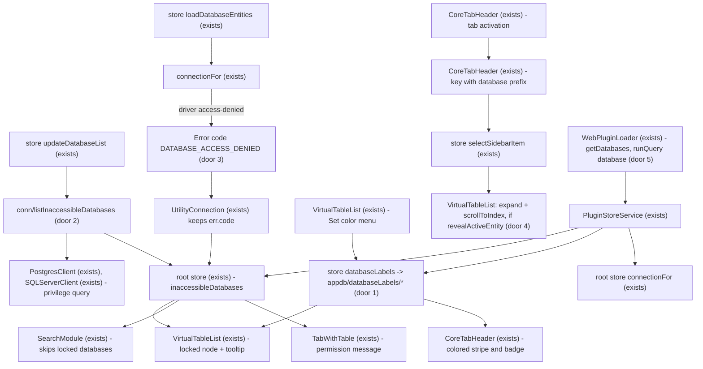
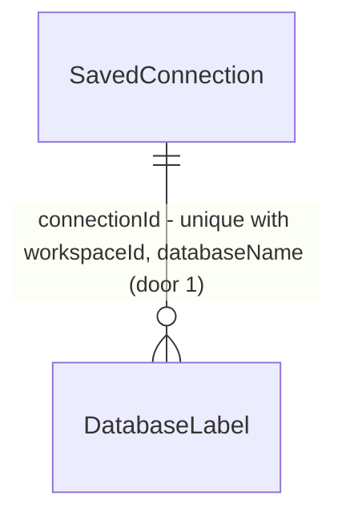

# Multi-database polish: locked databases, database colors, reveal in tree

## Problem

The database tree from `multi-database-navigation` treats every database of the server as
reachable. On a shared server, the current account often lacks access to some of them. Expanding
one today shows the raw driver error and a Retry that can never succeed, and nothing marks it
before the click. Databases look identical in the tree and in the tab bar, so a user with tabs on
`prod_a` and `prod_b` can only tell them apart by reading a small badge. Activating a tab bound to
a non-default database highlights the table with the same schema and name in the **default**
database. `CoreTabHeader` builds the selection key as `${tabType}.${schema}.${table}`
(`CoreTabHeader.vue:145-151`) with no database part, so the tree points at the wrong table and
never scrolls to the right one. The user reported all three after the first manual test
(2026-10-15) and gave no figures.

Once this ships:
- A database the account can't access is shown dimmed with a lock, can't be expanded, and explains
  why on hover or keyboard focus.
- Each database can have a color, shown in its tree label and on its tabs.
- Activating a tab highlights its own table in its own database. By default the tree also expands
  and scrolls to that table; a config key turns this off.

## Flow

This reuses `connectionFor` and `databaseEntities` from the previous feature, the connection color
palette (`ColorPicker.vue`, `connection-label-color-*` classes), `v-tooltip`, and the
`handlersFor` appdb pattern used by pins and hidden entities.

## Impact

| Front | What changes |
| --- | --- |
| domain | New term `inaccessibleDatabases` means the databases of the server the current account can't open, for this session. Read by `VirtualTableList`, `SearchModule` and `TabWithTable`. |
| domain | A database node gains a fourth state, `locked`, next to idle, loading, loaded and error. A locked node doesn't expand. |
| domain | New term `database label` means the color of one database of a saved connection. |
| behaviour | The sidebar selection key for a tab gains the database prefix used by the tree (`<db>::`) and uses the tab's `entityType` instead of `tabType`. `TableListItem.vue:218` and `StatelessTableListItem` compare against it. A view tab is now highlighted too; before, it never matched because the key said `table.`. |
| behaviour | `UtilityConnection` copies the utility's `errorCode` onto the rejected `Error` as `code`. Before, it was dropped for every non-plugin error, so a caller that checks `err.code` could see a value where it saw `undefined`. A grep found no renderer code that branches on `err.code` from utility calls. |
| stored data | New table `database_labels`. Nothing existing is migrated. |

## Relations

One-way constraint: unique (`connectionId`, `workspaceId`, `databaseName`) on `database_labels`
(door 1). Setting a color twice updates the row instead of adding a second one.

## Surface

Only the plugin API is consumed outside. `conn/listInaccessibleDatabases` and `appdb/databaseLabels/*`
are internal IPC routes (renderer ↔ utility, shipped together), recorded as doors 1 and 2.

The plugin bridge resolves or rejects a request and has no numeric statuses, so the signature is
listed here and each outcome owes a Coverage row in `checks.md`:

- **plugin request `getDatabases`**
  - in: none
  - out: `{ name, isDefault, accessible, color }[]`, one per database of the connection
  - outcomes: resolves with the list; resolves `[]` when the dialect has no multiple databases; rejects `noDatabase` when disconnected
- **plugin request `runQuery`**
  - in: `query`, optional `database`
  - out: unchanged (`results`)
  - outcomes: resolves on the given database's client; rejects with the driver error; rejects with code `DATABASE_ACCESS_DENIED` for a locked database
- **plugin tab serialization** (`getViewContext` and `openTab` replies): `query` and `table` tabs gain `databaseName`. This is a payload field, not a call.

## Landing

| One-way door | Literal shape | Alternative rejected |
| --- | --- | --- |
| 1 · Database colors table | migration `20261016_create_database_labels.js`: `CREATE TABLE database_labels (id integer PRIMARY KEY AUTOINCREMENT, connectionId integer NOT NULL, workspaceId integer NOT NULL DEFAULT -1, databaseName varchar NOT NULL, color varchar NOT NULL, createdAt…, updatedAt…, version integer NOT NULL DEFAULT 1)` + `CREATE UNIQUE INDEX database_labels_connection_database ON database_labels (connectionId, workspaceId, databaseName)`. Entity `DatabaseLabel`, handlers `handlersFor('databaseLabels', DatabaseLabel)`. | A JSON field on `saved_connection` (Q2=B): it would sync through Cloud Workspaces, but it changes a payload the cloud API owns. |
| 2 · Privilege listing | `BasicDatabaseClient.listInaccessibleDatabases(): Promise<string[]>` returns `[]` by default. Postgres family: `SELECT datname FROM pg_database WHERE NOT datistemplate AND NOT has_database_privilege(datname, 'CONNECT')`. SQL Server: `SELECT name FROM sys.databases WHERE HAS_DBACCESS(name) = 0`. IPC `conn/listInaccessibleDatabases`. | Folding a flag into `listDatabases` (`{name, accessible}[]`): it changes a return type that every dialect and `changeNamespace` consume. The plugin API doesn't expose `listDatabases`; the first draft of this plan said it did, which was wrong. |
| 3 · Access-denied error code | the utility rethrows a driver access-denied error as `Error(message)` with `code = 'DATABASE_ACCESS_DENIED'`. Recognised: Postgres `42501`, MySQL/MariaDB errno `1044` / `ER_DBACCESS_DENIED_ERROR`, SQL Server `916` and `4060`. `UtilityConnection` keeps it as `err.code`. | Matching message text in the renderer: it depends on the server's language and version. |
| 4 · Config key | `[ui.tableList] revealActiveEntity = true` in `default.config.ini`, typed in `bksConfig.d.ts` | A user setting in the settings UI: no settings screen covers the table list today. |
| 5 · Plugin API (additive) | new request `getDatabases` → `{ name: string, isDefault: boolean, accessible: boolean, color: string \| null }[]`; serialized `query`/`table` tabs gain `databaseName: string \| null`; `runQuery` accepts an optional `database: string` (omitted = default database). Declared in the app as a local extension of `RequestMap` (`AppRequestMap`) until `@beekeeperstudio/plugin` ships the types. Existing requests and payload keys are unchanged. | Changing `getConnectionInfo().databaseName` to the active tab's database: existing plugins read it as the connection's database. |

Note (added during verification, 2026-10-16): door 1's literal says `version ... DEFAULT 1`. The migration uses `DEFAULT 0`, like every other appdb table (`hidden_schemas`, `hidden_entities`). TypeORM's version column manages the value either way.

## Criteria

### S1: Locked databases (P1)

**Acceptance Criteria**

1. WHEN `listInaccessibleDatabases` runs on Postgres for a role without `CONNECT` on database `secret` THEN the system SHALL return a list that contains `secret` and not the role's own database
2. WHEN `listInaccessibleDatabases` runs on SQL Server THEN the system SHALL run a query that selects `sys.databases` names where `HAS_DBACCESS(name) = 0` and SHALL return those names
3. WHERE a client doesn't override `listInaccessibleDatabases`, the system SHALL return `[]`
4. IF connecting to a non-active database fails with Postgres code `42501`, MySQL errno `1044`, or SQL Server number `916` or `4060` THEN `connectionFor` SHALL reject with an error whose `code` is `DATABASE_ACCESS_DENIED`
5. IF connecting to a non-active database fails with any other error THEN `connectionFor` SHALL reject with that error unchanged
6. WHEN the utility rejects a call with an `errorCode` THEN the system SHALL expose that value as `code` on the renderer's rejected `Error`
7. WHEN `updateDatabaseList` runs THEN the store SHALL set `inaccessibleDatabases` to the names `conn/listInaccessibleDatabases` returned, and IF that call fails THEN the store SHALL set `[]` and still commit the database list
8. WHEN `loadDatabaseEntities(db)` fails with code `DATABASE_ACCESS_DENIED` THEN the store SHALL add `db` to `inaccessibleDatabases`
9. WHILE a database is in `inaccessibleDatabases`, its tree node SHALL render class `locked`, a lock icon, `aria-disabled="true"` and `tabindex="0"`, and expanding it SHALL NOT dispatch `loadDatabaseEntities`
10. WHILE a database is in `inaccessibleDatabases`, its tree node SHALL have a tooltip that reads `No permission to access database <name> with the current account (<username>)` and is triggered on hover and on focus. Without a username, the text ends after `account`.
11. WHEN the store's `clearConnection` runs THEN `inaccessibleDatabases` SHALL be `[]`
12. WHILE a database is in `inaccessibleDatabases`, the Quick Search index SHALL contain no database item and no entity for it
13. IF a tab is bound to a database in `inaccessibleDatabases` THEN the tab SHALL show `No permission to access database <name> with the current account` instead of its table

**Independent test:** connect to Postgres as a role without `CONNECT` on `secret`. `secret` shows dimmed with a lock and its tooltip, and expanding it does nothing.

### S2: Database colors (P2)

**Acceptance Criteria**

14. WHEN a color is set twice for the same connection, workspace and database THEN `database_labels` SHALL hold one row with the latest color
15. WHEN the user picks `purple` with **Set color** on a database node THEN the system SHALL persist it, and the node's label bar SHALL have class `connection-label-color-purple`
16. WHEN the user picks `default` THEN the system SHALL delete that database's row, and the label bar SHALL have no `connection-label-color-*` class
17. WHILE a tab is bound to a database with a color (the default database included), `CoreTabHeader` SHALL render the tab stripe and the database badge with class `connection-label-color-<color>`
18. WHERE the connection is unsaved (no `id`), setting a color SHALL update the store only and SHALL send no `appdb/databaseLabels/*` request
19. WHEN a saved connection connects THEN the store SHALL load the labels whose `connectionId` and `workspaceId` match it

**Independent test:** set `analytics` to purple. Its tree label and every tab on `analytics` show purple, and the color survives a reconnect.

### S3: Reveal the active tab's table in its own database (P1)

**Acceptance Criteria**

20. WHEN a `table` or `table-properties` tab bound to database `b` becomes active THEN `selectedSidebarItem` SHALL equal `b::table.public.users` for table `public.users`
21. WHEN a tab on view `public.v` of the default database becomes active THEN `selectedSidebarItem` SHALL equal `view.public.v`
22. WHERE `ui.tableList.revealActiveEntity` is `true`, WHEN that tab becomes active THEN `VirtualTableList` SHALL expand the `b` node (dispatching `loadDatabaseEntities` if it isn't loaded) and its schema node, and SHALL call `scrollToIndex` with the item's index in the displayed list
23. WHERE `ui.tableList.revealActiveEntity` is `false`, WHEN that tab becomes active THEN `VirtualTableList` SHALL change no node's expansion and SHALL NOT call `scrollToIndex`
24. The system SHALL declare `revealActiveEntity = true` under `[ui.tableList]` in `default.config.ini` and type it in `bksConfig.d.ts`

**Independent test:** with `public.users` in both `a` (default) and `b`, open `b`'s `users` from Quick Search. The tree expands `b`, scrolls to it, and highlights `b`'s `users`.

### S4: Plugin API knows about databases (P2)

**Acceptance Criteria**

25. WHEN a plugin sends `getDatabases` THEN the system SHALL return one entry per database of `databaseList`, with `isDefault` true only for the default database, `accessible` false only for databases in `inaccessibleDatabases`, and `color` set to the database's label color or `null`
26. WHERE the dialect sets `disabledFeatures.multipleDatabases`, `getDatabases` SHALL return `[]`
27. WHEN a plugin sends `runQuery` with `database: "b"` THEN the system SHALL send `conn/executeQuery` with `database: "b"`, and WHEN `database` is omitted THEN the system SHALL send no `database` key
28. WHEN a `query` or `table` tab is serialized for a plugin THEN the payload SHALL include `databaseName` equal to the tab's database, or to the default database when the tab has none, and a `table` tab SHALL resolve its table from that database's entities
29. The system SHALL return `getConnectionInfo().databaseName` equal to the connection's default database, unchanged

**Independent test:** a plugin calls `getDatabases`, then runs `runQuery` with `database: "analytics"` and gets rows from `analytics` while the default stays `app_prod`.

## Out of scope

| Excluded | Why |
| --- | --- |
| Privilege pre-check for MySQL, ClickHouse and other dialects | Q1=C: these fall back to detecting the error on the first attempt |
| Syncing colors across machines or Cloud Workspaces | Q2=A |
| A free color picker | It reuses the connection palette |
| Re-checking a locked database on a timer | It resets on reconnect or on a database-list refresh |
| Publishing the new request types in `@beekeeperstudio/plugin` | The package lives in another repository and is installed from npm. The contract is fixed here (door 5) for that release. |
| Changing the bundled plugins (`bks-ai-shell`, `bks-er-diagram`) to use the tab's database | They live in other repositories |

## Assumptions

| Assumption | Chosen default | Rationale | Confirmed? |
| --- | --- | --- | --- |
| Lock lifetime | session only; the next `updateDatabaseList` recomputes it from the proactive list and drops lazy marks | permissions can change; the list refresh is the existing re-check | n |
| Default database locked | not applicable; the connection itself fails today | — | n |
| Reveal trigger | on every tab activation, not only on open | matches what the user described as following the active table | n |
| Username in tooltip | `usedConfig.username`; omitted when empty | no extra round trip | n |
| Color entry point | context menu on the database node, with the existing `ColorPicker` in a small modal | the tree has no other editing surface | n |

**Open questions:** none. Q1 (proactive where supported, error fallback) and Q2 (local table per saved connection) were answered by the user in Lavish.

## Observable

| Surface | Decision | Landing |
| --- | --- | --- |
| screen tree database node | locked state | AC 9 |
| screen tree database node | locked explanation, keyboard reachable | AC 10 |
| screen tree database node | error state (non-permission) | existing - message + Retry from multi-database-navigation |
| screen tree database node | color | AC 15, 16 |
| screen tab header | color | AC 17 |
| screen table tab | permission state | AC 13 |
| screen Quick Search | locked databases | AC 12 |
| screen tree | selection and scroll | AC 20-23 |
| screen color modal | destructive action confirms | n/a - choosing default only removes a color |
| IPC routes | versioning, rate limits | n/a - internal, shipped together |
| plugin API | versioning | AC 29 - additive only; existing requests and fields keep their meaning |
| plugin API | error shape | Surface - the driver error, or code `DATABASE_ACCESS_DENIED` |
| UI copy | neutral tone (CLAUDE.md) | AC 10, 13 |

## Sources

- User request (2026-10-15) after the first manual test, and the Lavish answers Q1=C and Q2=A.
- The user's plan review (2026-10-15): approved, with plugin API support added. Their scope answer: extend the API additively (S4).
